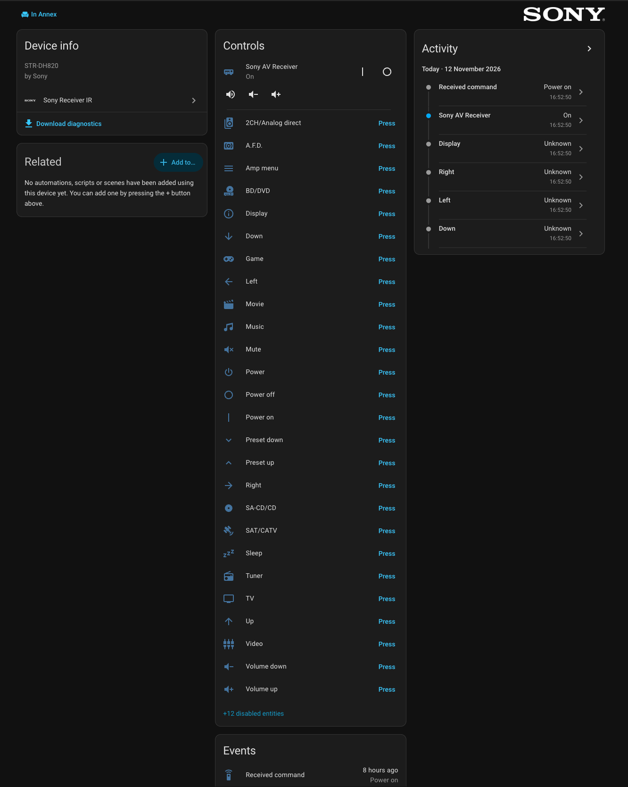

# Sony Receiver IR for Home Assistant

A Home Assistant custom integration that controls **Sony AV receivers**
(STR-DH, STR-DN, STR-DG and similar) over infrared. It is built the same way
as Home Assistant's
[`lg_infrared`](https://github.com/home-assistant/core/tree/dev/homeassistant/components/lg_infrared)
integration and is a sibling of
[ha-sony-bravia-ir](https://github.com/googanhiem/ha-sony-bravia-ir). It
sends commands through any entity from Home Assistant's `infrared`
integration, for example an ESPHome device with an IR LED. It can also listen
to the original Sony remote through an infrared receiver.

> [!IMPORTANT]
> **Tested models:** this integration is being tested with the
> **Sony STR-DH820**. Other Sony receivers share the same command set and
> should work, but they are untested. Reports from other models, working or
> not, are welcome as issues.

## Screenshot

The **Sony AV Receiver** device page in Home Assistant, controlling a Sony STR-DH820:



## Requirements

- Home Assistant **2026.8** or newer. It needs the `infrared` integration
  and its emitter/receiver helpers.
- At least one `infrared` emitter entity (to control the receiver) and/or
  receiver entity (to react to the physical remote), e.g. from ESPHome.

## Installation

### HACS

1. HACS → ⋮ → *Custom repositories* → add this repository's URL, category **Integration**.
2. Install **Sony Receiver IR** and restart Home Assistant.

### Manual

Copy `custom_components/sony_receiver_ir` into your Home Assistant
`config/custom_components/` folder and restart.

## Setup

*Settings → Devices & services → Add integration → Sony Receiver IR*, then choose:

| Field | Meaning |
| --- | --- |
| **Model** | Optional, e.g. `STR-DH820`. Only used to name the device. |
| **Infrared emitter** | Used to send commands. Needed for the media player and buttons. |
| **Infrared receiver** | Optional. Turns presses on the original remote into events. |

At least one emitter or receiver is required. You can change all of these
later with *Reconfigure*.

### Renaming the inputs

The four HDMI inputs (**BD/DVD**, **GAME**, **SAT/CATV** and **VIDEO**) can
be given your own names, for example *PS5* or *Apple TV*. Go to
*Settings → Devices & services → Sony Receiver IR → Configure* and fill in
a name for any of them. Leave a field empty to keep Sony's name.

The new names are used in the media player's source list (so you can pick
*PS5* in a dashboard or an automation) and on the matching buttons. The
button entity IDs (e.g. `button.sony_av_receiver_game`) stay the same, so
existing automations keep working. Each input needs a different name, which
must also differ from TV, SA-CD/CD and TUNER.

## What you get

All entities belong to one device, **Sony AV Receiver**.

| Platform | Entity | Needs |
| --- | --- | --- |
| `media_player` | `media_player.sony_av_receiver`: on/off (discrete codes), volume step, mute, source select (BD/DVD, GAME, SAT/CATV, VIDEO, TV, SA-CD/CD, TUNER; the four HDMI inputs can be renamed) | emitter |
| `button` | One button per remote key (38 in total; see the table below) | emitter |
| `event` | `event.sony_av_receiver_received_command`: fires with the key name when the original remote is used | receiver |
| action | `sony_receiver_ir.send_sirc`: send any SIRC code | emitter |

### Limits of infrared

- IR only sends, so the integration never reads anything from the receiver.
  Power state and input are *assumed* from the last command Home Assistant
  sent, and are restored after a restart. Using the original remote does not
  change the media player state.
- There is no volume level; volume is up/down steps only.
- Mute is a toggle on Sony receivers.
- The sound field keys (2CH, A.F.D., Movie, Music) cycle through the modes of
  their group on each press, as on the remote, so they are buttons rather
  than a sound mode list.
- Some keys are not included yet: **Enter / the centre menu key**, **Return**
  and the **HDMI output / BT / USB** keys on newer remotes. No source
  agreed on their codes. Capture them as described below.

### Sending a key that has no button

1. With a receiver set up, press the key on the original remote and look at
   `event.sony_av_receiver_received_command`. Its attributes show
   `address`, `address_bits` and `command`. Unmapped keys on a receiver
   address appear as event type `unknown`.
2. Send it from a script or automation:

```yaml
action: sony_receiver_ir.send_sirc
target:
  entity_id: media_player.sony_av_receiver
data:
  address: 176      # 0xB0
  address_bits: 8   # 15-bit SIRC
  command: 12
```

Please open an issue with the codes you capture so they can be added.

## How the codes are sent

Sony receivers use 15-bit Sony **SIRC** on two addresses: `0x30` for the
amplifier (power, volume, mute, inputs, numbers) and `0xB0` for sound
fields, the amp menu and cursor keys. Each command goes out as **three
identical frames**, because Sony devices ignore a single frame. The encoder
uses `infrared_protocols.commands.sony.SonyCommand`. Decoding of received
signals is built in, so it works with every `infrared-protocols` version
Home Assistant has shipped.

The *Source* column says where each code comes from:

- **irdb**: the [irdb](https://github.com/probonopd/irdb) database,
  `codes/Sony/Receiver/48,-1.csv` and `176,-1.csv`.
- **LIRC**: a capture of the RM-AAU014 receiver remote from the
  [LIRC remotes database](https://sourceforge.net/p/lirc-remotes/code/ci/master/tree/remotes/sony/RM-AAU014.lircd.conf).
  The tests check these codes bit for bit against it.
- **assumed**: newer remotes renamed some inputs (DVD → BD/DVD,
  VIDEO 1 → VIDEO, VIDEO 2 → GAME, SAT → SAT/CATV). These buttons send the
  code of the input they replaced; the mapping has not been confirmed yet.
  If one selects the wrong input on your receiver, capture the right code
  from the remote as described above.

| Button | Enabled by default | Address | Command | Source |
| --- | --- | --- | --- | --- |
| Power | yes | `0x30` | `0x15` | irdb + LIRC |
| Power on | yes | `0x30` | `0x2E` | irdb |
| Power off | yes | `0x30` | `0x2F` | irdb |
| Sleep | yes | `0x30` | `0x60` | irdb + LIRC |
| Volume up | yes | `0x30` | `0x12` | irdb + LIRC |
| Volume down | yes | `0x30` | `0x13` | irdb + LIRC |
| Mute | yes | `0x30` | `0x14` | irdb + LIRC |
| BD/DVD | yes | `0x30` | `0x7D` | assumed (DVD) |
| Game | yes | `0x30` | `0x1E` | assumed (VIDEO 2) |
| SAT/CATV | yes | `0xB0` | `0x03` | assumed (SAT) |
| Video | yes | `0x30` | `0x22` | assumed (VIDEO 1) |
| Video 3 | no | `0x30` | `0x42` | irdb + LIRC |
| TV | yes | `0x30` | `0x6A` | irdb + LIRC |
| SA-CD/CD | yes | `0x30` | `0x25` | irdb + LIRC |
| Tuner | yes | `0x30` | `0x21` | irdb + LIRC |
| Preset up | yes | `0x30` | `0x10` | irdb |
| Preset down | yes | `0x30` | `0x11` | irdb |
| 0 | no | `0x30` | `0x09` | irdb + LIRC |
| 1 | no | `0x30` | `0x00` | irdb + LIRC |
| 2 | no | `0x30` | `0x01` | irdb + LIRC |
| 3 | no | `0x30` | `0x02` | irdb + LIRC |
| 4 | no | `0x30` | `0x03` | irdb + LIRC |
| 5 | no | `0x30` | `0x04` | irdb + LIRC |
| 6 | no | `0x30` | `0x05` | irdb + LIRC |
| 7 | no | `0x30` | `0x06` | irdb + LIRC |
| 8 | no | `0x30` | `0x07` | irdb + LIRC |
| 9 | no | `0x30` | `0x08` | irdb + LIRC |
| 2CH/Analog direct | yes | `0xB0` | `0x41` | irdb + LIRC |
| A.F.D. | yes | `0xB0` | `0x42` | irdb + LIRC |
| Movie | yes | `0xB0` | `0x43` | irdb + LIRC |
| Music | yes | `0xB0` | `0x49` | irdb + LIRC |
| Amp menu | yes | `0xB0` | `0x77` | LIRC |
| Up | yes | `0xB0` | `0x78` | LIRC |
| Down | yes | `0xB0` | `0x79` | LIRC |
| Left | yes | `0xB0` | `0x7A` | LIRC |
| Right | yes | `0xB0` | `0x7B` | LIRC |
| Display | yes | `0x30` | `0x4B` | LIRC |
| Test tone | no | `0xB0` | `0x4A` | irdb |

Disabled buttons can be enabled from the entity settings.

## Development

```bash
uv venv --python 3.14 .venv
uv pip install --python .venv -r requirements_test.txt
.venv/bin/pytest
```

## Trademarks

Sony and the Sony logo are trademarks of Sony Group Corporation. The logo
in `brand/` is the Sony image from the
[Home Assistant brands repository](https://github.com/home-assistant/brands/tree/master/core_brands/sony)
and is only used as this integration's icon on Home Assistant's
integrations page, to identify the devices it controls. This is
an unofficial, community project and is not affiliated with or endorsed by
Sony.

## License

MIT
